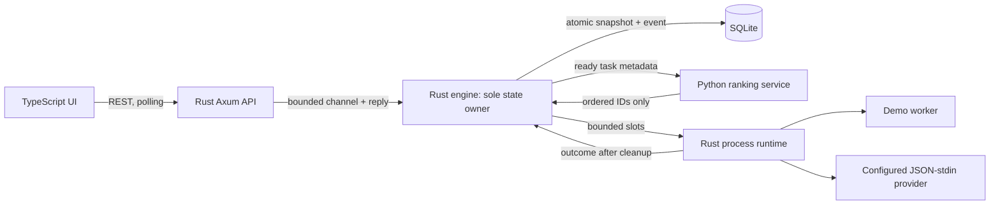

# MVP architecture

## Invariants

- **One writer:** only the engine owns the task map and SQLite connection. An OS advisory lock prevents a second core from owning the same database, even on another port. SQLite transactions commit task snapshots and journal events together.
- **Capacity follows resources:** a running task occupies its slot until its runtime finishes cleanup and reports an outcome. A cancellation request does not free capacity immediately.
- **Transitions are checked:** queued → running/cancelled/blocked; running → succeeded/failed/cancelled/timed_out/interrupted. Terminal tasks cannot restart. Cancellation accepted before completion processing wins over a concurrent success result.
- **DAG by construction:** a new task can depend only on already-existing IDs, with at most 32 unique dependencies. Specs/dependency edges cannot be edited. This prevents cycles without a graph-editing API. Failed dependencies propagate to blocked descendants.
- **Python is advisory:** it receives only ready tasks. Rust requires schema version 1 and an exact permutation, with no missing, duplicate or foreign IDs. HTTP/parse/validation errors, oversized responses and timeouts fall back to Rust FIFO.
- **Bounded runtime output:** stdout and stderr are drained concurrently; only the first 8 KiB from each is kept. Child stdin is closed after one JSON envelope. External executable path/arguments/cwd come from the operator's registry, never the request.
- **Recover conservatively:** queued work remains queued; a saved running task is marked interrupted after restart. No automatic retry can duplicate unknown external effects. On orderly shutdown, running processes are cancelled and reaped; queued tasks persist.

## Runtime and scheduling

The engine checks readiness at most every 100 ms and selects up to the available worker slots. A policy HTTP request can occupy the actor for up to 300 ms; this adds latency to state-changing API calls in the worst case. Runtime completion messages wait on a bounded channel during that interval. This is a simple local MVP, not a zero-latency scheduler.

Processes use separate Unix process groups. Timeout/cancellation sends SIGKILL to the group and reaps the direct child. Ordinary descendants holding output pipes are terminated too. The runtime also closes remaining group members after direct-child completion, so long-lived background daemons are not supported providers. Deliberate session detachment and abrupt core/host termination are not contained; process groups are not sandboxing.

The event journal is read with `after` cursors (up to 100 events per request). It records state transitions and cancellation requests. The UI catches up one page per polling cycle and displays the latest 12 received entries. Snapshot reads include captured final output. There is no WebSocket, SSE, log replay stream, message delivery outbox or deletion API.

## Policy behavior

| Policy | Primary order | Main tradeoff |
| --- | --- | --- |
| FIFO | Created time, then ID | Predictable age order; short tasks may wait behind long ones |
| SJF | Lowest estimated duration | Can reduce average wait; depends on estimates; long tasks can starve under sustained arrivals |
| Priority | Highest priority (0..10) | Favors urgent work; low-priority starvation is possible |
| Aging | Highest `(1 + priority / 10) × (1 + wait / estimate)` | Priority-weighted HRRN heuristic; responds to waiting time; no universal fairness/optimality guarantee |

All ties use created time then ID. All policies are non-preemptive. Aging uses the supplied estimate, not the demo's actual duration. Changing policy affects subsequent dispatches; it does not preempt or reorder running work. Policy choice and last dispatch source are runtime settings, not persisted task data.

## Deliberate scale limits

Small local queues (1,000 retained tasks), one engine, one database, identical capacity slots, no resource classes, no distributed leases. SQLite operations are synchronous and snapshots are in memory. Journal retention, API pagination, DB schema migration tooling, log streaming, crash-safe external process ownership and authentication are deferred. The current module boundaries make those follow-up projects explicit without pretending they exist already.
